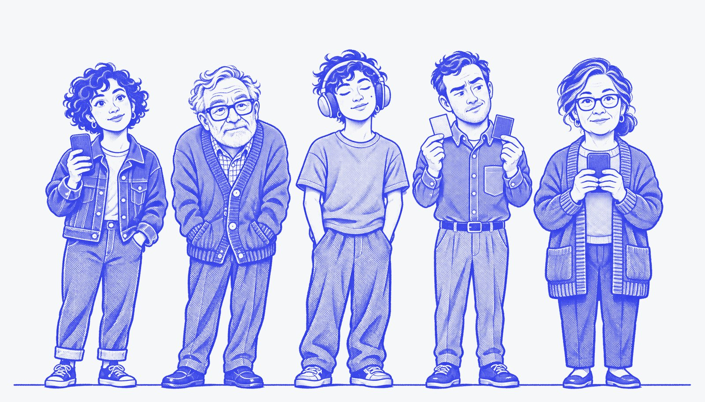

# Hallway Test



**Watch five simulated people try your web page, each with real limits.**

You change a page, then ask Hermes: *"hallway test localhost:3000/signup — sign up with sam@example.com"*.
Five people open it in their own browsers and try:

| Person | Limit, enforced in code |
|---|---|
| **Maya**, first-time visitor | Reads labels literally; nothing hidden is assumed |
| **Walter**, 72, low vision | Text under 13.5px or below 3:1 contrast is unreadable to him |
| **Jordan**, screen-reader user | Blind: hears only the accessibility tree; Tab, arrows, Enter and Space only |
| **Ryan**, red-green colour blind | Reds and greens are reported to him as "brownish" |
| **Nina**, hand tremor | Every tap lands up to 9px off target |

Add your own people too (up to 8 per run): *"also add Priya, 80, who uses only the keyboard and needs large text"*
becomes a custom person built from the same enforced limits (`low_vision`, `screen_reader`, `keyboard_only`,
`colour_blind`, `tremor`).

The model never pretends to have these limits. The plugin decides what each person can perceive (from computed
font sizes, contrast ratios, colours and the accessibility tree) and what they can do (mouse or keyboard, tap
accuracy). The model only sees that filtered view and picks the next action, one step at a time. That is why
the results are real barriers and not role-play.

You get back:

- **Who finished and who gave up**, in their own words ("I can't tell which seats are free, they all look brown").
- **Taps that did nothing** and **false finishes** (someone thought they were done but the task wasn't complete).
- **3–5 prioritised findings**, each with who it blocked, evidence from the run, and a specific fix.
- **A full HTML report** with step-by-step replays (every screen as that person saw it, where they tapped, what they thought).
- **A 1200×675 summary card** to drop in a PR or a post.
- **Before/after**: pass `compare_url` to run the same people on your fix and see 1/5 → 5/5.

In Hermes Desktop, the **Hallway Test** page in the sidebar follows a run live, like a usability lab's monitor wall
(each person's current screen and thought), and shows finished reports.

## Try it in 30 seconds

```
hermes plugins install lexipej/hallway-test --enable
```

Restart Hermes (in Desktop: Capabilities → Plugins → Rescan, turn on **Hallway Test**, then restart the gateway), then ask:

> Run a hallway test on the demo, before and after fixes.

or type `/hallway demo`. The demo is **Pier 9 Live**, a small concert seat picker bundled with the plugin (`url: "demo"`),
and its repaired version (`"demo:fixed"`). On the broken one each person hits a different wall: seats shown only in
red and green, 14px seats packed tightly, seats that aren't real buttons, faint row letters. It is served on
`127.0.0.1` only.

## Using it on your own pages

Ask Hermes in plain words, or call the `hallway_test` tool:

| Field | |
|---|---|
| `url` | Any page this machine can open, including `http://localhost:…` dev servers |
| `task` | What people should try to do, with any details they need ("…use the email sam@example.com") |
| `success_text` | Text that only appears when the task is done. Strongly recommended: success is then verified, not self-reported |
| `compare_url` | Optional second version for before/after |
| `personas` | Optional subset, e.g. `["keyboard", "low_vision"]` |
| `custom_personas` | Up to 3 extra people: `{name, about, traits}` with traits from `low_vision`, `screen_reader`, `keyboard_only`, `colour_blind`, `tremor` |
| `facts` | Test credentials and other things the people know |
| `device` | `mobile` (default, 420×860) or `desktop` (1280×800) |

## Requirements and settings

- Hermes 0.23 or newer. No extra API keys: the people run on a model you already have in Hermes.
- **Choosing the model.** Hallway Test registers its own model slot, **Hallway Test** ("Simulated testers"), under
  Settings → Model → Auxiliary models (or `auxiliary.hallway_test` in `config.yaml`). Left on Auto it uses your main
  Hermes model. A run makes 40-150 short calls, so pointing it at a fast, inexpensive model (a "flash" or "mini"
  model) keeps runs quick and cheap while your chat stays on whatever model you like. The model picked inside a
  single chat does not change it.
- Python dependency: `playwright` (installed with the plugin). For the browser it uses Playwright's Chromium if
  present, otherwise the Microsoft Edge or Google Chrome already on your machine. It never downloads a browser
  itself; to use Playwright's Chromium, run `python -m playwright install chromium` in the Hermes environment.
- Settings (Hermes Desktop: Settings → Plugins → hallway-test): `max_steps` (16), `parallel` (3 browsers at a time,
  max 6) and `time_budget_seconds` (330, so a run always answers inside Hermes's tool timeout).
- Gentle on your machine: animated pages are slowed to about 5 frames a second for the testers, audio is muted, and a
  browser only starts when at least 1.2 GB of memory is free.

A run makes one model call per person per step plus one for the findings: typically 40–120 short calls and
1–4 minutes for five people (twice that for before/after).

## Disclosure

- **Browsing:** launches headless browser instances on your machine and opens only the URLs you give it (and the
  bundled demo). It clicks and types into those pages as the personas, which can submit forms, so point it at dev or
  staging environments, not production accounts.
- **Model calls:** the filtered text of each screen, the task and the `facts` you provide are sent to your configured
  model provider through Hermes. Screenshots are not sent.
- **Local files:** screenshots, run state and reports are written to `<hermes home>/plugin-data/hallway-test/runs/`.
  Nothing is read outside that folder and the plugin's own directory.
- **Local server:** the demo app is served by a small HTTP server bound to `127.0.0.1` on a random port, started only
  when you use `url: "demo"`.
- No telemetry, no third-party services, no stored credentials, no shell commands, no self-updating.

## Limits, honestly

Simulated people are not real users. The low-vision and colour-blind views are models (font size, contrast and a
deuteranopia mapping), and the screen-reader view is Chromium's accessibility tree rather than NVDA or VoiceOver.
Contrast is only judged on solid backgrounds (text on images or gradients is assumed readable), and results vary a
little from run to run because a model makes each decision. Hallway Test is for catching barriers early and often;
it does not replace testing with disabled people. Pages behind CAPTCHAs or SSO need a test login you pass in `facts`.

## Development

```
cd tests
python -m pytest -q
```

The tests use the bundled demo, a small fixture app with known barriers, and a rule-based stand-in for the model,
so they run offline.

Built with AI assistance (Claude, Codex) for the Nous Research Hermes Agent plugin hackathon. The portraits were made with
Codex image generation and recoloured for the report. Report typefaces: Barlow Condensed and Space Mono, both under the
SIL Open Font License 1.1 (licences in `assets/fonts/`). Plugin code: MIT licensed.
